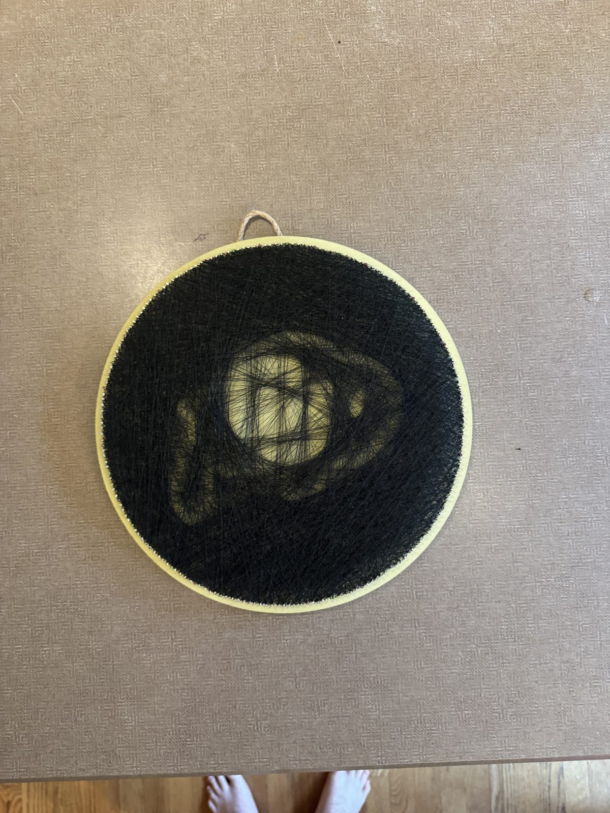
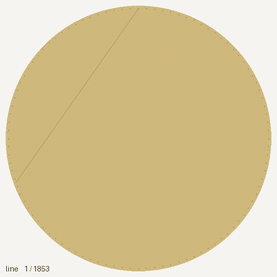
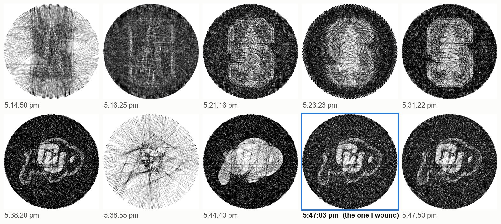
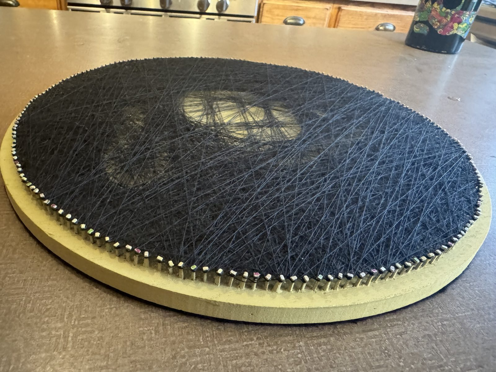
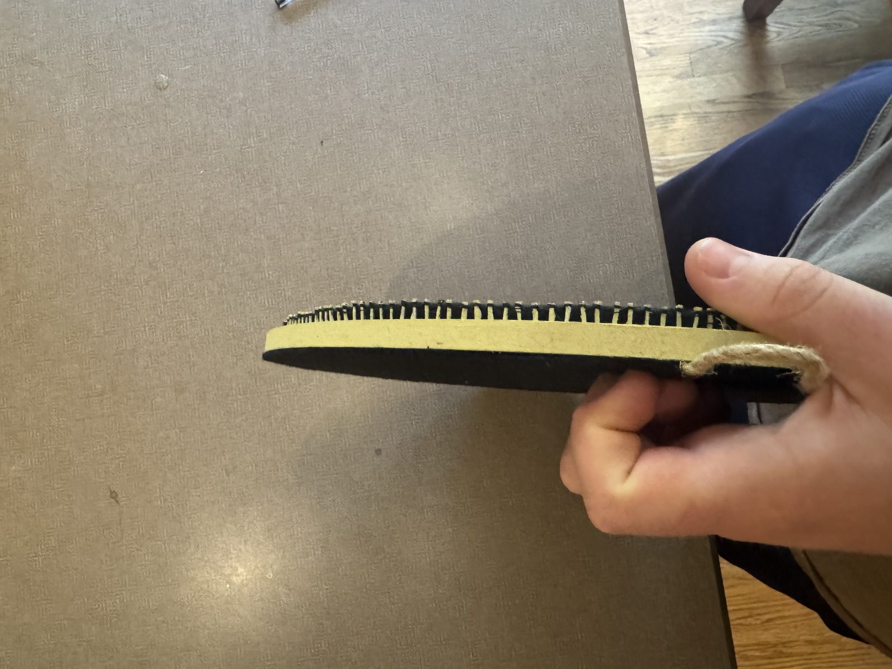
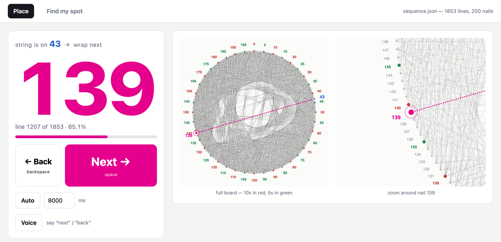
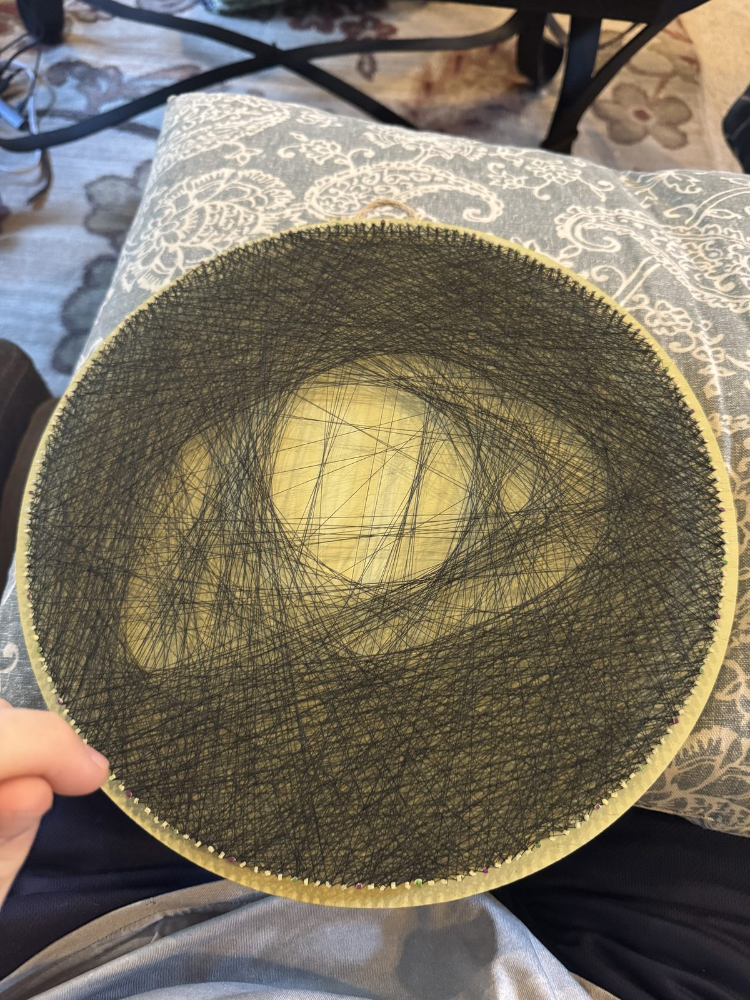

# String Art

<p align="center">
  
  
</p>

A program that turns an image into a list of nails to wrap thread around, and the piece I made with it: the Colorado Buffaloes logo in 1,853 lines of black thread, on a 12-inch round with 200 nails. That's about 463 yards of thread and 6.4 hours of winding. The GIF is every line in the order I wound it.

## How it went

### August 16, afternoon: a solver and 66 tries

I started out planning a portrait, and the first runs that afternoon were on photos. A 12-inch circle is a small canvas, though, and I switched to logos: about 30 runs on the Stanford block S, then the CU Buffaloes logo.



Those are 10 of the 66 runs between 4:41 and 5:48 pm (the photo runs aren't shown). The trick that made it work is the black background. The solver puts thread wherever the image is dark, so the background fills in with black and the logo stays bare board. On a gold board that's black and gold. With the target inverted (the 5:38:55 run above), the logo got the thread instead and it came out as a starburst. The run I wound is from 5:47 pm: 1,853 lines, 76% mean coverage.

### Before the 21st: the board

<p>
  
  
</p>

200 nails, 4.5 mm apart on an 11.3-inch circle, laid out with a true-scale template from `template.py` (it prints a 1-inch calibration square on every page, so you can check the printer didn't scale it). I painted every 10th nail head red and every 5th green, so I could count off from the nearest mark while winding.

### August 21: the winder, then winding



That morning I built a visual winder (`place.py`) to sit next to the board. It shows the next nail as a huge number, draws the whole ring with the same red and green marks as the board, and zooms in around the target nail. Space goes to the next line, it can auto-advance on a timer or listen for "next" and "back", and it saves my position on every move. There's also a "Find my spot" tab: type the last few nails you wrapped and it shows every place in the sequence that matches. It tracks working time, and it doesn't count gaps over 5 minutes, so breaks don't wreck the ETA.



That's 5:55 pm, partway in. The last line went on at 10:02 pm. The log says 6.4 hours of actual winding, about 12 seconds a line overall, and the last 400 lines went on at about 8 seconds each (which matches the auto-advance default, 8 seconds).

## How it works

### The solver (`stringart.py`)

It's greedy. The target image becomes a "residual": how much darker each pixel still wants to be. From the current nail, every legal chord to another nail is scored by the mean residual along its pixels, the best one wins, its ink gets subtracted, and that nail becomes the next starting point. It stops when no chord improves anything.

The one non-obvious part: the residual is allowed to go negative. Those negative pixels are what push later chords away from places that already have enough thread. If you clip it at zero, overdrawing becomes free, the solver keeps piling thread into the darkest spot, and the whole thing turns to mud without any error.

All 19,900 possible chords for 200 nails are precomputed once into flat arrays with an offset table, so each step is a gather plus a dot product. A full solve takes about 20 seconds.

### The physics

How much each line darkens the image comes from real dimensions instead of a tuning constant. One strand covers `thread_mm / board_mm` of the board's width, which at the solver's resolution is some fraction of a pixel. So the thread you buy decides how many lines you get before the image converges:

| Thread | Lines to converge (a photo on a 12" round) | Winding time |
|---|---|---|
| 0.2 mm all-purpose sewing | about 850 | about 1.5 h |
| 0.1 mm fine embroidery | about 1,600 | about 2.7 h |
| 0.05 mm silk | about 3,200 | about 5.5 h |

(Those are for a photo. The logo needed 1,853 lines with 0.2 mm thread, because the whole background is supposed to go black.)

Nail spacing has a floor too: `template.py` prints the center-to-center spacing, and below about 3 mm the nail heads collide.

### The tools

| File | What it does |
|---|---|
| `stringart.py` | The solver and renderers: a physically modeled simulation of the finished piece, a prettier vector preview, a 25/50/75/100% progress grid, and the sequence as text and JSON |
| `template.py` | Printable nail template, as 2x2 letter pages or one full-size page, with a calibration square |
| `place.py` + `templates/place.html` | The winder above (Flask, local only) |
| `caller.py` | A terminal winder that reads the sequence out loud (`say` on macOS, `espeak` on Linux) |
| `app.py` + `templates/index.html` + `static/` | A local web UI for uploading an image, tuning the parameters and comparing runs |
| `examples/cu-buffaloes/` | The sequence I wound (`sequence.json`, `sequence.txt`), its simulation and a render, and the winding log |

## Running it

```bash
pip install -r requirements.txt

python stringart.py input/your-image.png --nails 200 --diameter 12 --thread-mm 0.2
python template.py --nails 200 --diameter 12
python place.py --sequence out/sequence.json      # then open http://127.0.0.1:5002
```

`place.py` with no arguments opens the CU sequence from `examples/`. The tuning knobs are `--contrast`, `--gamma`, `--min-gap` (stops chords between neighboring nails, which cause a scalloped fringe at the rim), `--nails` and `--thread-mm`. Look at `out/target.png` before `simulation.png`: a disappointing result is usually a bad target image, not a bad solve.

`app.py` and `place.py` are Flask apps meant for localhost only (`app.py` runs with Flask's debugger on).

## Notes

- 12 inches is an honest canvas but it isn't a photograph. The well-known portrait pieces use 3,000 to 4,000 lines on boards twice this size.
- Ideas for a better solver: a lookahead or beam search instead of pure greedy, comparing blurred images instead of raw pixels (closer to what your eye does), denser nails where the image has detail, and more than one thread color.
- The Colorado Buffaloes logo belongs to the University of Colorado. The logo image itself isn't in this repo, only the nail sequence made from it.
